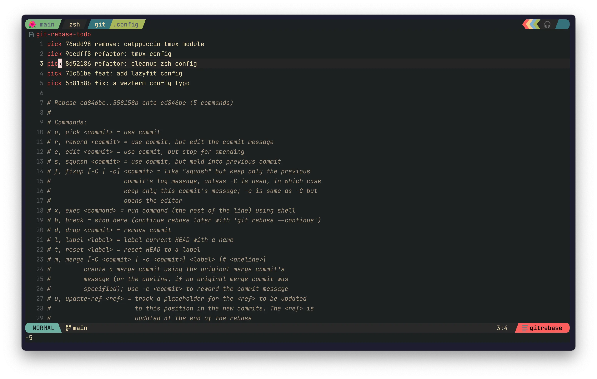
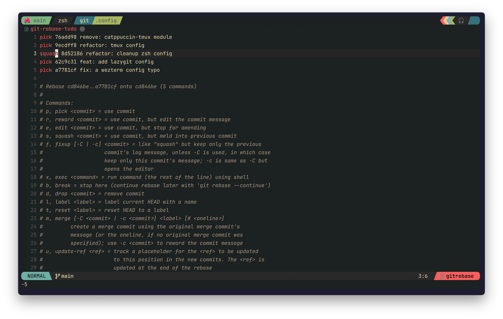
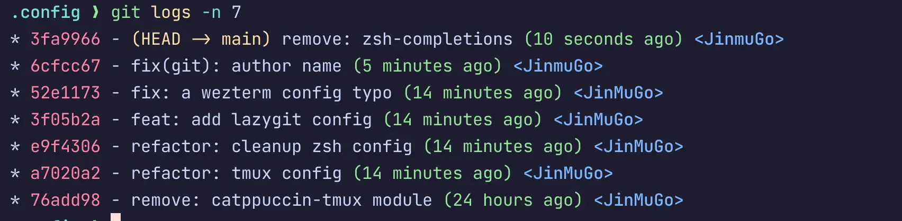
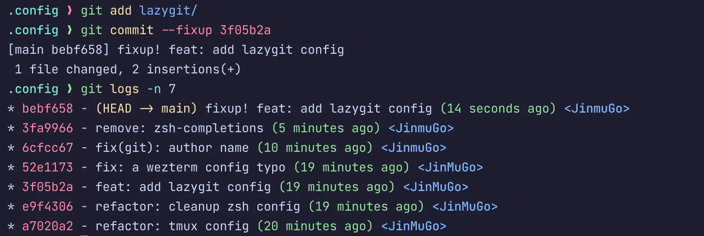
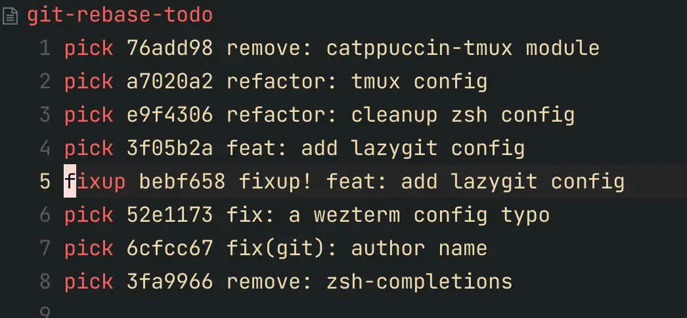
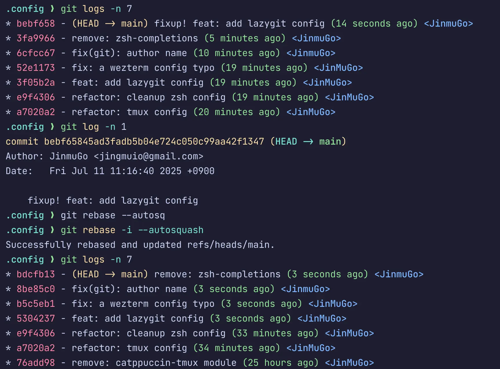

둘 다 현재 커밋을 앞선 커밋에 합치지만 차이는 **커밋 메시지 처리**입니다.

- `squash`: 두 커밋의 메시지를 모아 보여주고 최종 메시지를 편집합니다.
- `fixup`: 보완 커밋의 메시지를 버리고 대상 커밋의 메시지를 그대로 유지합니다.

이미 설명이 완성된 커밋에 오타나 누락을 보태는 작업이라면 `fixup`이 맞습니다. 여러 커밋의 의미를 하나로 재작성해야 한다면 `squash`를 씁니다.



## squash

Interactive rebase 목록에서 `squash` 또는 `s`로 바꾼 커밋은 바로 위 커밋에 합쳐집니다.

```text
pick   9ecdf8 refactor: tmux config
squash 8d5218 refactor: cleanup zsh config
```



Git은 합쳐질 커밋 메시지들을 에디터에 열어 줍니다. 최종 커밋이 두 작업을 모두 설명해야 하거나 메시지를 새로 정리하고 싶을 때 유용합니다.

대상 커밋을 미리 지정해 보완 커밋을 만들 수도 있습니다.

```bash
git commit --squash=<target-commit>
```

이 커밋은 `squash!` 접두사를 가지며, 뒤에서 설명할 `--autosquash`가 대상 위치로 옮겨 줍니다.

## fixup

`fixup` 또는 `f`도 변경 내용을 바로 위 커밋에 합칩니다. 기본 `fixup`은 보완 커밋의 메시지를 버리므로 메시지 에디터를 다시 열 필요가 없습니다.

제가 lazygit 설정 커밋 `3f05b2a`의 누락을 발견했다고 해보겠습니다.



수정 파일을 스테이징한 뒤 Git이 제공하는 `--fixup` 옵션으로 커밋을 만듭니다.

```bash
git add lazygit/
git commit --fixup=3f05b2a
```



Git이 `fixup! feat: add lazygit config` 같은 제목을 정확히 만들어 줍니다. 접두사를 손으로 작성할 수도 있지만 대상 제목이 바뀌거나 비슷한 커밋이 있을 때 실수하기 쉬우므로 `git commit --fixup=<commit>`을 쓰는 편이 안전합니다.

## autosquash로 대상 위치에 붙이기

보완 커밋은 작업 중인 HEAD에 만들어져 대상과 떨어져 있을 수 있습니다. `--autosquash`는 `fixup!`, `squash!`, `amend!` 커밋을 찾아 대상 바로 뒤로 이동하고 rebase 액션도 알맞게 바꿉니다.

```bash
git rebase -i --autosquash <base>
```

`<base>`에는 정리할 범위의 바로 앞 커밋을 지정합니다. 예시의 대상부터 정리하려면 다음처럼 실행할 수 있습니다.

```bash
git rebase -i --autosquash 3f05b2a^
```



목록을 확인하고 저장하면 보완 변경은 대상 커밋에 합쳐지고 `fixup!` 커밋은 사라집니다.



매번 옵션을 입력하기 싫다면 Git의 기본 설정을 사용할 수 있습니다.

```bash
git config --global rebase.autoSquash true
```

이 설정 뒤에도 `git rebase -i <base>`의 목록을 저장하기 전에는 배치를 직접 확인할 수 있습니다.

## 메시지도 고치고 싶을 때

최신 Git은 fixup 계열에서 메시지 교체까지 표현할 수 있습니다.

| 명령 | 결과 |
| --- | --- |
| `git commit --fixup=<commit>` | 변경을 합치고 기존 대상 메시지를 유지 |
| `git commit --fixup=amend:<commit>` | 변경을 합치며 대상 메시지의 수정안을 작성 |
| `git commit --fixup=reword:<commit>` | 파일 변경 없이 대상 메시지만 수정 |

`amend:`와 `reword:`는 `amend!` 커밋을 만들고, `--autosquash` rebase 때 그 메시지를 대상 커밋의 새 메시지로 사용합니다. 단순 보완에는 기본 `--fixup`이면 충분합니다.

## 한눈에 비교

| 기준 | `squash` | `fixup` |
| --- | --- | --- |
| 변경 내용 | 이전 커밋에 합침 | 이전 커밋에 합침 |
| 메시지 | 여러 메시지를 모아 편집 | 보완 메시지를 버리고 대상 메시지 유지 |
| 주 용도 | 여러 작업의 의미를 하나로 재작성 | 기존 커밋의 작은 누락·오타·리뷰 반영 |
| 빠른 생성 | `git commit --squash=<commit>` | `git commit --fixup=<commit>` |

## 안전하게 쓰는 범위

Rebase는 커밋 ID를 다시 만듭니다. 아직 공유하지 않은 로컬 브랜치에서 정리하는 것이 가장 안전합니다.

이미 원격에 올린 개인 브랜치를 꼭 고쳐야 한다면 팀원과 먼저 조율하고, 테스트 후 일반 `--force` 대신 다음 명령을 사용합니다.

```bash
git push --force-with-lease
```

`--force-with-lease`도 다른 사람이 같은 브랜치에서 작업 중일 때는 충돌을 없애 주지 않습니다. 공유 브랜치와 기본 브랜치의 공개 이력은 다시 쓰지 않는 편이 낫습니다.

제가 가장 자주 쓰는 흐름은 짧습니다.

```bash
git commit --fixup=<target>
git rebase -i --autosquash <base>
```

작업 중에는 보완점을 바로 fixup 커밋으로 남기고, 리뷰 전 한 번에 정리하면 메시지를 반복해서 고치는 수고 없이 읽기 좋은 이력을 만들 수 있습니다.

## 참고 자료

- [git commit 공식 문서](https://git-scm.com/docs/git-commit)
- [git rebase 공식 문서](https://git-scm.com/docs/git-rebase)
