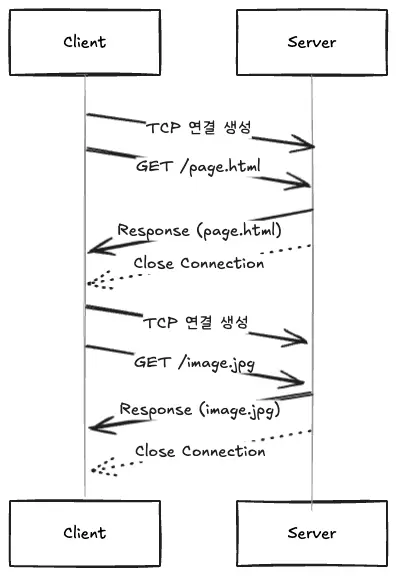
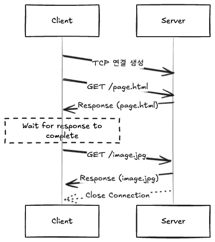
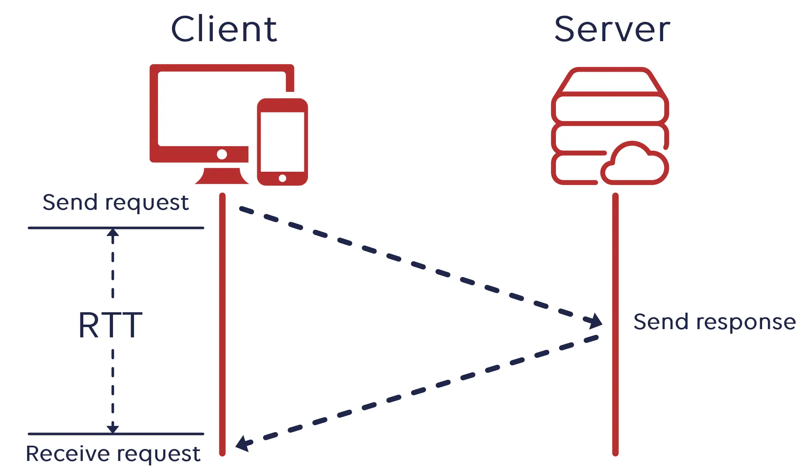
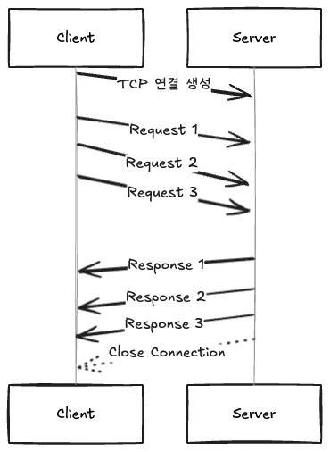
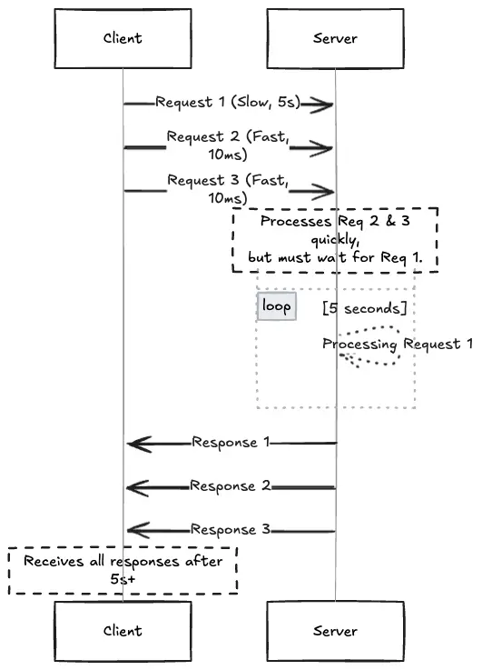

HTTP/1.1 파이프라이닝은 **앞선 응답을 기다리지 않고 같은 연결에 여러 요청을 연속으로 보내 RTT 낭비를 줄이는 기능**입니다. 하지만 서버는 응답을 요청 순서대로 보내야 했고, 첫 응답이 늦으면 뒤의 빠른 응답도 막히는 애플리케이션 계층 HOL(Head-of-Line) 블로킹이 생겼습니다. 이 한계와 까다로운 오류 복구 때문에 널리 쓰이지 못했고, HTTP/2의 스트림 다중화가 그 역할을 대신했습니다.

## HTTP/1.0: 기본은 요청마다 새 연결

HTTP/1.0의 기본 모델은 비영속 연결입니다. HTML, CSS, 이미지처럼 리소스를 하나 요청할 때마다 TCP 연결을 만들고 응답을 받은 뒤 닫습니다.



TCP 핸드셰이크와 느린 시작 비용이 요청마다 반복되므로 리소스가 많은 페이지에서는 지연이 커집니다. 당시 일부 구현은 `Keep-Alive` 확장으로 연결을 재사용했지만, HTTP/1.0의 기본 동작은 아니었습니다.

## HTTP/1.1: 연결을 재사용해도 대기는 남는다

HTTP/1.1은 별도 종료 지시가 없는 한 영속 연결을 기본으로 사용합니다. 한 번 만든 TCP 연결을 여러 요청에 재사용하므로 연결 설정 비용은 줄어듭니다.



그렇다고 요청 사이의 대기가 자동으로 사라지는 것은 아닙니다. 요청 하나를 보내고 응답을 모두 받은 뒤 다음 요청을 보내면, 각 왕복 사이에 연결이 놀게 됩니다.

> RTT(Round Trip Time)는 요청이 상대에게 갔다가 응답이 돌아오기까지 걸리는 왕복 시간입니다. TCP 연결 수립뿐 아니라 HTTP 요청과 응답의 지연을 설명할 때도 쓰입니다.



## 파이프라이닝의 동작

파이프라이닝을 사용하면 클라이언트는 첫 응답을 기다리지 않고 같은 연결에 요청을 이어서 씁니다.

1. 클라이언트가 영속 TCP 연결을 만듭니다.
2. 요청 1, 2, 3을 응답 대기 없이 연속으로 보냅니다.
3. 서버는 여러 요청을 처리합니다.
4. 서버는 **요청과 같은 순서로** 응답 1, 2, 3을 전송합니다.



여러 요청을 한 번의 왕복 구간에 밀어 넣을 수 있으므로 높은 지연 환경에서 이론적인 이득이 큽니다. 다만 메서드에 관한 규칙은 ‘멱등 메서드만 허용’처럼 한 문장으로 단순화하면 정확하지 않습니다.

- 서버는 안전한 메서드의 요청을 병렬 처리할 수 있습니다.
- 연결이 중간에 끊겼을 때 클라이언트가 자동 재시도해도 되는지는 멱등성에 달려 있습니다.
- 클라이언트는 멱등하지 않은 요청을 보낸 뒤 최종 응답을 받기 전에는 추가 요청을 파이프라이닝하지 않는 것이 원칙입니다. 따라서 POST가 프로토콜 차원에서 무조건 금지되는 것은 아니지만, 복구가 어렵기 때문에 보수적으로 다뤄야 합니다.

## 응답 순서가 만든 HOL 블로킹

HTTP/1.1 메시지에는 여러 응답을 뒤섞어 보내고 다시 조립할 스트림 식별자가 없습니다. 그래서 서버는 요청을 병렬로 처리했더라도 응답을 요청 순서대로 보내야 합니다.

```text
1. GET /api/complex-report  → 5초
2. GET /images/logo.png     → 10ms
3. GET /styles.css          → 10ms
```

2번과 3번 결과가 먼저 준비되어도 1번 응답이 끝날 때까지 전송할 수 없습니다. 큐의 머리가 뒤 항목을 가로막는 이 현상이 HTTP/1.1 파이프라이닝의 HOL 블로킹입니다.



브라우저와 중간 프록시가 파이프라이닝을 일관되게 구현하기 어려웠고, 연결 실패 뒤 어느 요청을 안전하게 다시 보낼지도 판단해야 했습니다. 실전에서는 여러 TCP 연결을 병렬로 여는 방식이 더 예측 가능했고 파이프라이닝은 주류가 되지 못했습니다.

## HTTP/2와 HTTP/3는 무엇을 바꿨나

HTTP/2는 하나의 연결 안에서 요청과 응답을 프레임으로 나누고 스트림 ID로 구분합니다. 느린 스트림 하나가 있어도 다른 스트림의 응답 프레임을 먼저 보낼 수 있으므로 **HTTP/1.1의 애플리케이션 계층 HOL 블로킹**을 없앴습니다.

하지만 모든 스트림이 하나의 TCP 연결을 공유합니다. TCP 패킷 하나가 유실되면 그 패킷이 재전송될 때까지 연결 위의 스트림들이 함께 기다릴 수 있습니다. 이것은 **전송 계층의 HOL 블로킹**입니다.

HTTP/3는 TCP 대신 QUIC을 사용하고 스트림별 전송 상태를 분리해, 한 스트림의 패킷 손실이 다른 스트림까지 막는 문제를 줄였습니다.

정리하면 파이프라이닝의 아이디어 자체—한 연결을 놀리지 않고 여러 작업을 겹치는 것—는 맞았습니다. 실패한 부분은 응답을 순서대로 내보내야 하는 HTTP/1.1의 메시지 구조였고, 이후 버전은 스트림 식별과 다중화로 그 제약을 제거했습니다.

## 참고 자료

- [RFC 9112: HTTP/1.1](https://www.rfc-editor.org/rfc/rfc9112.html)
- [RFC 9113: HTTP/2](https://www.rfc-editor.org/rfc/rfc9113.html)
- [RFC 9114: HTTP/3](https://www.rfc-editor.org/rfc/rfc9114.html)
