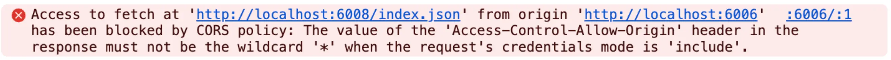
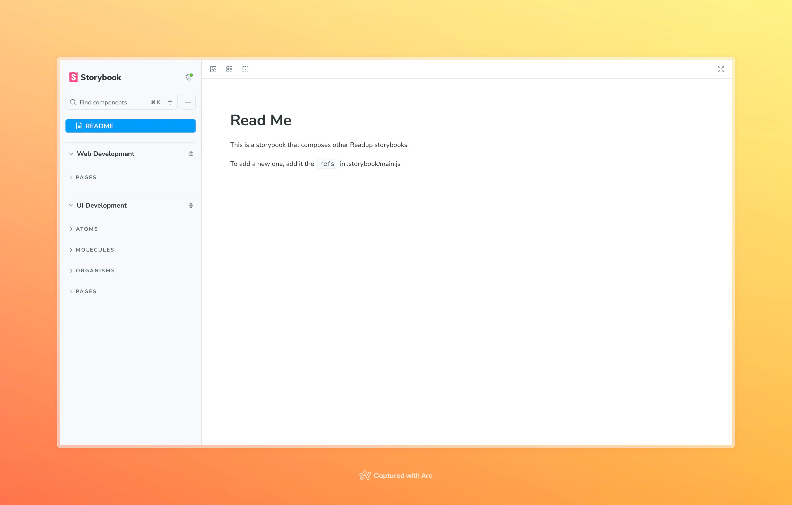

모노레포에서 Next.js 앱과 UI 패키지의 Storybook을 분리하고도 한곳에서 보고 싶다면, **각 Storybook은 독립적으로 실행하고 중앙 Storybook의 `refs`로 연결**하면 됩니다. 이것이 Storybook Composition입니다.

다만 Composition이 항상 필요한 것은 아닙니다. 현재 Storybook은 Next.js 전용 프레임워크를 제공하므로, 의존성과 배포 주기가 같은 작은 프로젝트라면 Next.js Storybook 하나에서 UI 패키지 스토리까지 읽는 편이 더 단순합니다. 저는 UI 패키지와 웹 앱의 설정·소유권·배포를 분리할 필요가 있어 Composition을 선택했습니다.

## 사용한 구조

처음에는 `packages/ui`의 컴포넌트만 공통 Storybook에서 보여주고 있었습니다. 서비스 페이지의 조합과 Provider 상태까지 확인하려고 `apps/web` 코드를 그대로 가져오자, Next.js 환경과 웹 앱의 의존성이 공통 Storybook으로 번졌습니다.

그래서 다음처럼 역할을 나눴습니다.

```text
monorepo/
├── apps/
│   ├── storybook/          # Composition 호스트, :6006
│   └── web/
│       └── .storybook/     # Next.js 앱 Storybook, :6008
└── packages/
    └── ui/
        └── .storybook/     # UI 패키지 Storybook, :6007
```

- `packages/ui`: 재사용 컴포넌트와 디자인 시스템 스토리
- `apps/web`: 실제 페이지, 레이아웃, 앱 Provider에 의존하는 스토리
- `apps/storybook`: 컴포넌트 코드를 가져오지 않고 두 Storybook을 탐색하는 허브

Next.js 앱에는 현재 권장되는 `@storybook/nextjs-vite`를 사용합니다. Next.js 14.1 이상과 Vite 5 이상이 필요하며, `next/image`, 라우팅, `next/head`, 폰트 같은 기능을 지원합니다. Composition을 택한 이유는 Next.js를 Storybook에서 실행할 수 없어서가 아니라 **각 영역의 의존성과 설정을 격리하기 위해서**입니다.

## 로컬 Composition 설정

호스트인 `apps/storybook/.storybook/main.ts`에 `refs`를 추가합니다.

```ts
import type { StorybookConfig } from "@storybook/react-vite"

const config: StorybookConfig = {
  stories: ["../src/README.mdx"],
  framework: "@storybook/react-vite",
  refs: (config, { configType }) => {
    if (configType === "DEVELOPMENT") {
      return {
        ui: {
          title: "UI Development",
          url: "http://localhost:6007",
        },
        web: {
          title: "Web Development",
          url: "http://localhost:6008",
        },
      }
    }

    return {
      ui: {
        title: "UI",
        url: "https://main--<ui-app-id>.chromatic.com",
      },
      web: {
        title: "Web",
        url: "https://main--<web-app-id>.chromatic.com",
      },
    }
  },
}

export default config
```

포트 매핑은 처음부터 끝까지 같아야 합니다.

| 역할 | 주소 |
| --- | --- |
| Composition 호스트 | `http://localhost:6006` |
| UI 패키지 | `http://localhost:6007` |
| Next.js 웹 앱 | `http://localhost:6008` |

Storybook은 참조 URL의 `index.json`을 읽어 스토리 목록을 탐색 패널에 표시합니다. 따라서 `http://localhost:6007/index.json`과 `http://localhost:6008/index.json`이 브라우저에서 열려야 합니다. 참조 Storybook의 프레임도 사용자의 브라우저가 직접 불러오므로, 사내 주소나 인증이 필요한 주소라면 열람자도 접근 권한이 있어야 합니다.

## 세 Storybook을 순서에 안전하게 실행하기

각 Storybook을 별도 터미널에서 켜도 됩니다.

```bash
# 터미널 1
pnpm --filter ./packages/ui storybook -- --port 6007

# 터미널 2
pnpm --filter ./apps/web storybook -- --port 6008

# 터미널 3
pnpm --filter ./apps/storybook storybook -- --port 6006
```

Turborepo처럼 세 작업을 병렬 시작하면 호스트가 먼저 뜰 수 있습니다. 이때 참조 서버가 아직 준비되지 않아 `index.json` 요청이 실패합니다. 호스트 패키지의 스크립트에서 이미 사용 중인 `wait-on`으로 두 메타데이터 URL이 2xx를 반환할 때까지만 기다리면 됩니다.

```json
{
  "scripts": {
    "storybook": "wait-on http-get://localhost:6007/index.json http-get://localhost:6008/index.json && storybook dev -p 6006"
  }
}
```

`http-get://`를 쓴 이유는 포트가 열렸는지만 보는 것이 아니라 실제 `index.json`에 GET 요청을 보내 성공 응답을 확인하기 위해서입니다.

### ‘CORS 오류’와 준비 실패를 구분하기

제가 처음 본 콘솔 메시지는 다음과 같았습니다.



`wait-on`이 해결하는 것은 **시작 순서 경쟁**뿐입니다. 참조 서버가 완전히 뜬 뒤에도 브라우저가 `Access-Control-Allow-Origin`이나 credentials 오류를 표시한다면 이는 실제 CORS 설정 문제이므로, 참조 Storybook을 제공하는 프록시·호스팅의 응답 헤더나 동일 출처 구성을 고쳐야 합니다. 대기 시간을 늘려서는 해결되지 않습니다.

확인은 두 단계면 충분합니다.

1. 참조 Storybook의 `/index.json`이 2xx와 JSON을 반환하는지 확인
2. 호스트 Storybook을 열어 UI와 Web 항목이 탐색 패널에 표시되는지 확인



## Chromatic 배포 주소 연결하기

배포 환경에서도 UI, Web, Composition을 각각 빌드합니다. 호스트의 `refs`에는 매 빌드마다 달라지는 주소 대신 Chromatic의 브랜치 permalink를 넣었습니다.

```text
https://<branch>--<appid>.chromatic.com
```

예를 들어 `main` 브랜치라면 `https://main--<appid>.chromatic.com` 형태입니다. 이 주소는 해당 브랜치의 최신 빌드를 가리키므로 호스트 설정을 매번 바꿀 필요가 없습니다.

공개 범위도 함께 확인해야 합니다. Composition 호스트가 공개되어 있어도 참조한 Chromatic 프로젝트가 비공개라면 권한 없는 사용자는 스토리를 볼 수 없습니다.

## 언제 Composition을 선택할까

다음 조건이면 Composition의 분리 비용이 의미가 있었습니다.

- UI 패키지와 앱의 Storybook 프레임워크 또는 설정이 다르다.
- 각 영역을 다른 팀이 소유하거나 독립적으로 배포한다.
- 호스트가 참조 패키지의 런타임 의존성을 가져서는 안 된다.
- 여러 저장소나 기술 스택의 Storybook을 한 탐색 패널에서 봐야 한다.

반대로 같은 팀이 같은 주기로 배포하고 스토리 수가 많지 않다면 단일 Storybook이 더 낫습니다. Composition은 코드를 합치는 기능이 아니라 **이미 실행 가능한 Storybook들을 URL로 묶는 기능**이므로, 참조 대상의 빌드·호스팅·접근 권한은 여전히 각각 관리해야 합니다.

## 참고 자료

- [Storybook Composition 공식 문서](https://storybook.js.org/docs/sharing/storybook-composition)
- [Storybook for Next.js with Vite 공식 문서](https://storybook.js.org/docs/get-started/frameworks/nextjs-vite/?renderer=react)
- [Chromatic permalink 문서](https://www.chromatic.com/docs/permalinks/)
- [wait-on 저장소](https://github.com/jeffbski/wait-on)
- [Turborepo의 Storybook 가이드](https://turborepo.com/docs/guides/tools/storybook)
