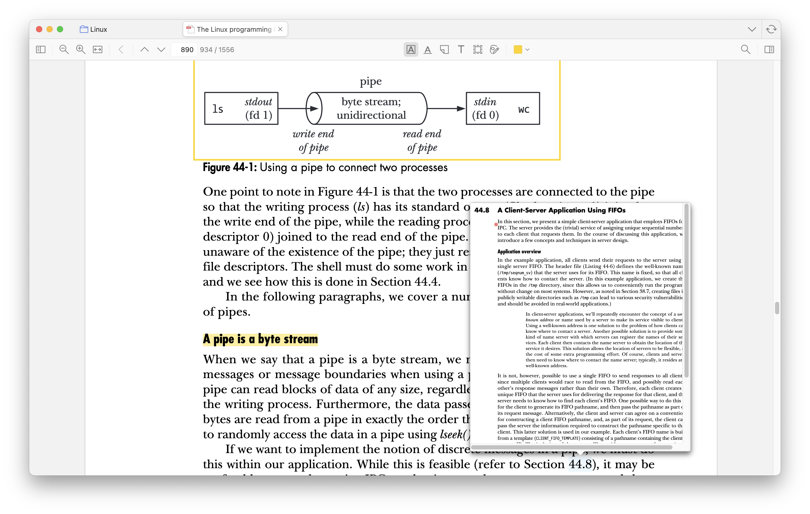
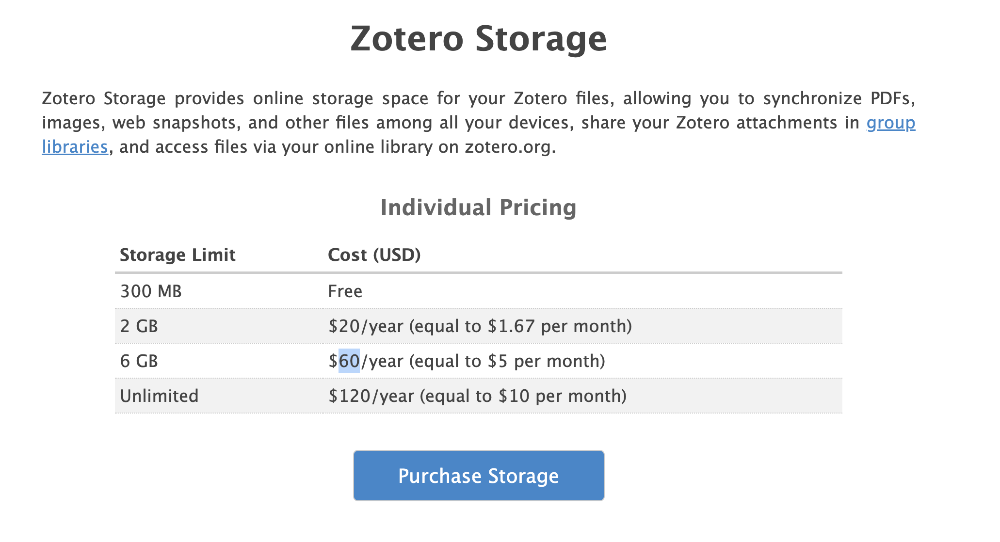
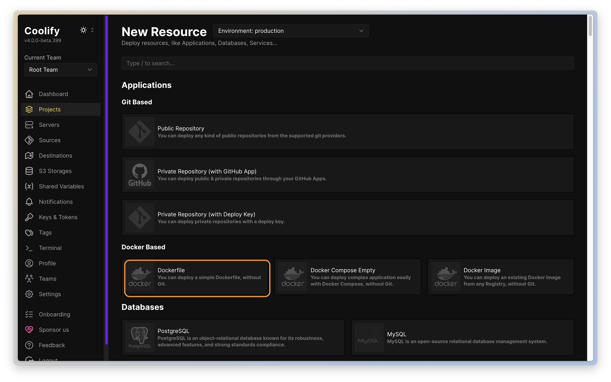
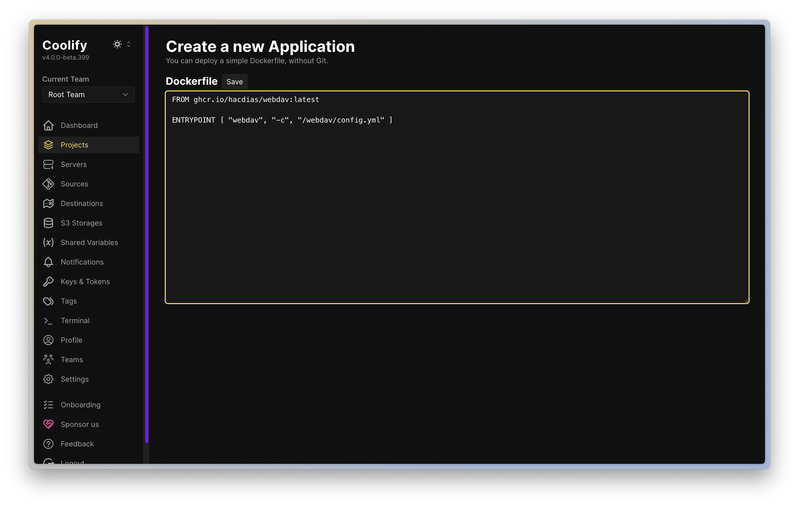
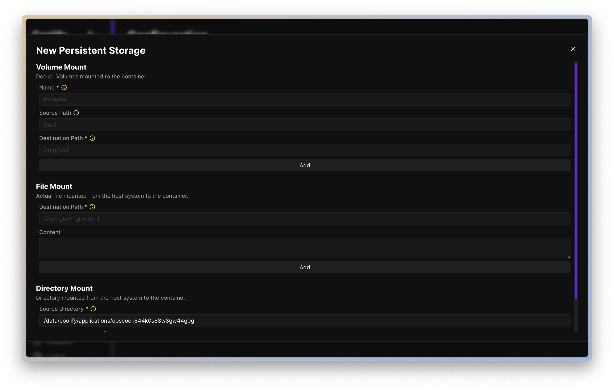
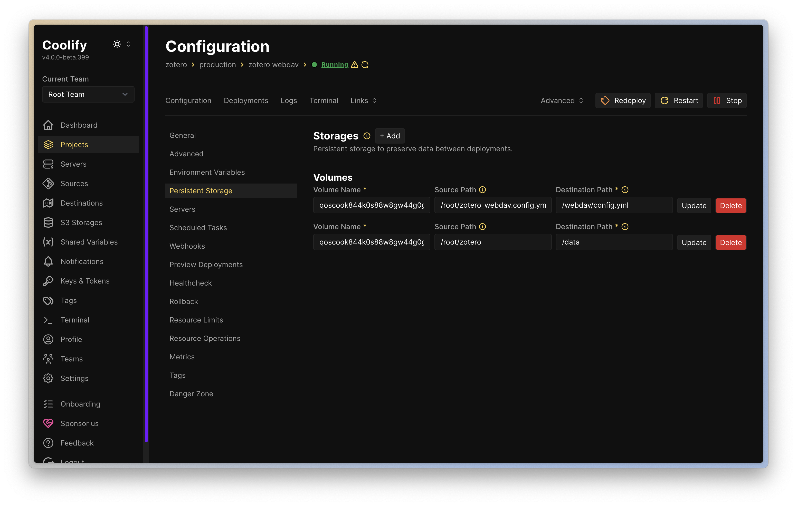
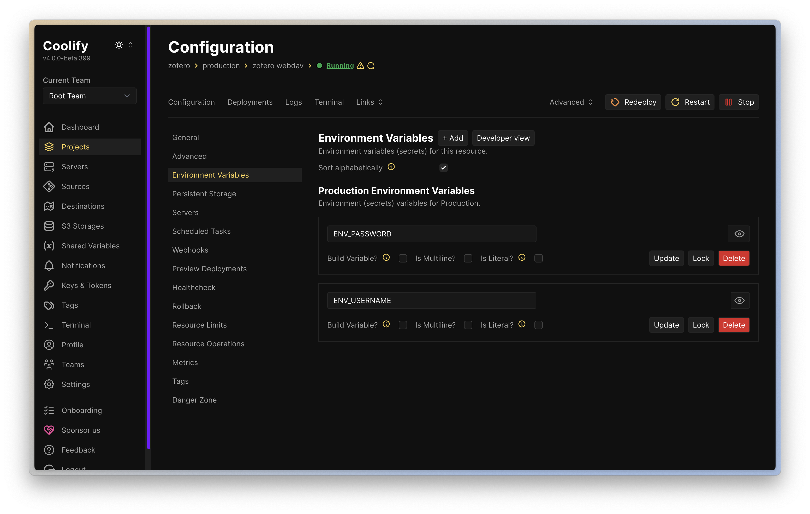
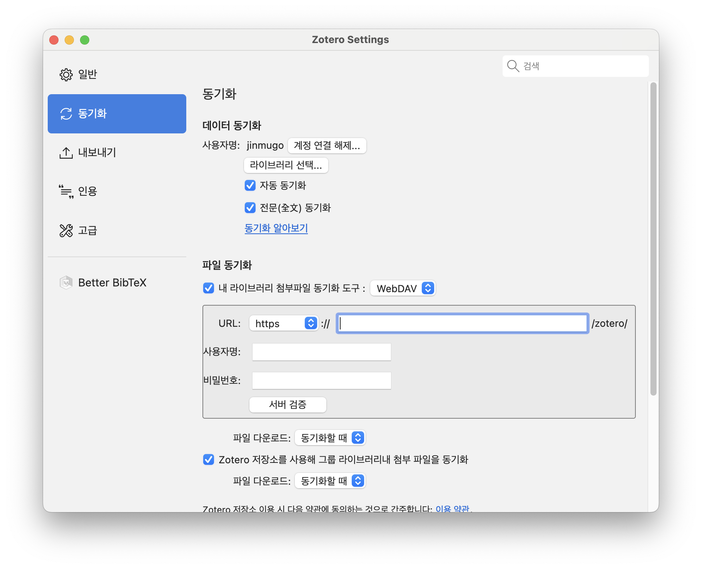

Zotero에서 직접 운영하는 WebDAV 서버를 쓰려면 **WebDAV 컨테이너에 영구 저장소와 인증 정보를 연결하고, HTTPS 도메인으로 공개한 뒤 Zotero에서 ‘서버 검증’을 실행**하면 됩니다. 저는 남는 OCI 인스턴스의 Coolify에 [hacdias/webdav](https://github.com/hacdias/webdav)를 배포했습니다.

먼저 범위를 정확히 짚고 가겠습니다.

| 동기화 대상 | 담당 서비스 |
| --- | --- |
| 서지 항목, 컬렉션, 태그, 노트 | Zotero 데이터 동기화 |
| 개인 라이브러리의 PDF·이미지 등 첨부파일 | 이 글의 WebDAV 서버 |
| 그룹 라이브러리 첨부파일 | Zotero Storage만 지원 |

WebDAV가 Zotero 계정 전체를 대체하는 것은 아닙니다. 공식 문서 기준으로 WebDAV는 **개인 라이브러리의 첨부파일 동기화에만** 쓰이며, 그룹 라이브러리에는 사용할 수 없습니다.

## 왜 직접 운영했나

저는 PDF를 Zotero에서 읽고 하이라이트와 메모를 남긴 뒤, 아이패드와 맥북에서도 같은 첨부파일을 이어서 보고 싶었습니다.



Zotero Storage가 가장 간단하고 호환성도 좋지만, 무료 첨부파일 용량을 넘으면 유료 요금제가 필요합니다.



이미 운영 중인 서버가 있었기 때문에 WebDAV를 선택했습니다. 새 VPS를 이 용도로만 결제해야 한다면 서버 비용, 업데이트, 백업 시간을 포함해 Zotero Storage와 먼저 비교하는 편이 낫습니다.

## 구성

요청 경로는 단순합니다.

```text
Zotero → HTTPS 도메인 → Coolify 리버스 프록시 → webdav:6065 → /data
```

- Coolify가 TLS 인증서와 외부 도메인을 담당합니다.
- WebDAV 컨테이너는 내부 `6065` 포트에서 실행합니다.
- `/data`는 재배포 뒤에도 남는 볼륨에 저장합니다.
- 사용자명과 비밀번호는 Coolify 환경변수로 주입합니다.

## 1. WebDAV 설정 파일 만들기

전체 예시 설정을 복사할 필요는 없습니다. Zotero에 필요한 최소 설정은 다음과 같습니다.

```yaml
address: 0.0.0.0
port: 6065
tls: false
behindProxy: true
directory: /data
permissions: CRUD

users:
  - username: "{env}ENV_USERNAME"
    password: "{env}ENV_PASSWORD"
```

`tls: false`인 이유는 TLS 종료를 Coolify가 맡기기 때문입니다. 컨테이너를 인터넷에 포트로 직접 노출한다면 이 구성을 그대로 사용하면 안 됩니다. Zotero 로그인 정보는 HTTP Basic 인증으로 전달되므로 외부 접속은 반드시 HTTPS여야 합니다.

CORS 설정은 넣지 않았습니다. Zotero 데스크톱·모바일 앱은 브라우저에서 다른 출처로 `fetch`하는 웹 앱이 아니므로 이 구성에 CORS 허용 목록은 필요하지 않습니다.

## 2. 버전을 고정한 컨테이너 준비하기

Coolify에서 Dockerfile 애플리케이션을 만들고 다음 두 줄을 입력합니다.

```dockerfile
FROM ghcr.io/hacdias/webdav:v5.15.0
ENTRYPOINT ["webdav", "-c", "/config.yml"]
```

`latest` 대신 제가 확인한 버전을 고정했습니다. 자동으로 새 이미지를 받아 예기치 않게 동작이 바뀌는 일을 피하고, 업데이트는 릴리스 노트를 확인한 뒤 태그를 바꾸는 방식입니다.





애플리케이션의 노출 포트는 `6065`로 설정하고 도메인을 연결합니다. WebDAV 프로세스는 모든 인터페이스(`0.0.0.0`)에서 들어오는 연결을 받아야 Coolify 프록시가 접근할 수 있습니다.

## 3. 설정과 데이터를 영구 저장하기

Coolify의 **Persistent Storage**에서 두 항목을 만듭니다.

1. 설정 파일: File Mount로 위 YAML을 `/config.yml`에 읽기 전용으로 연결
2. 첨부파일: Volume Mount를 `/data`에 연결





컨테이너 파일 시스템은 재배포할 때 바뀔 수 있습니다. `/data`를 영구 볼륨에 연결하지 않으면 첨부파일을 잃을 수 있습니다.

## 4. 인증 정보와 HTTPS 도메인 설정하기

**Environment Variables**에 다음 두 값을 추가합니다.

- `ENV_USERNAME`: Zotero에 입력할 사용자명
- `ENV_PASSWORD`: 길고 고유한 비밀번호



비밀번호를 Dockerfile이나 저장소에 직접 적지 않습니다. 배포 후에는 Coolify가 발급한 HTTPS 도메인으로 접속되는지 확인하고, 외부에 `6065` 포트를 별도로 열어두지 않습니다.

## 5. Zotero에서 WebDAV 연결하기

Zotero의 **설정 → 동기화 → 파일 동기화**로 이동합니다.

1. ‘내 라이브러리 첨부파일 동기화 도구’를 **WebDAV**로 변경합니다.
2. 프로토콜은 `https`를 선택합니다.
3. URL에는 도메인만 입력합니다. Zotero가 끝에 `/zotero`를 자동으로 붙입니다.
4. `ENV_USERNAME`, `ENV_PASSWORD` 값을 입력합니다.
5. **서버 검증**을 눌러 성공하는지 확인합니다.



검증에 성공하면 동기화 버튼을 눌러 작은 PDF 하나부터 올려봅니다. 다른 기기에서 같은 Zotero 계정으로 로그인한 뒤 첨부파일이 열리는지까지 확인해야 설정이 끝난 것입니다.

## 운영 전에 꼭 확인할 것

- **백업:** Coolify의 영구 볼륨은 백업이 아닙니다. `/data`를 다른 서버나 객체 저장소에 주기적으로 복사하고 실제 복원도 시험합니다.
- **업데이트:** 이미지 태그를 고정하고, 새 버전은 백업 후 수동으로 올립니다.
- **HTTPS:** 인증 정보와 파일을 보호하려면 외부 URL은 HTTPS만 사용합니다.
- **용량:** 서버 디스크 사용량과 백업 보존 기간을 모니터링합니다.
- **장애 범위:** 자체 WebDAV 장애는 Zotero가 지원해 주지 않습니다. 문제가 생기면 먼저 서버 로그, 저장소 권한, 인증서, `/zotero` 경로를 확인합니다.

직접 운영은 기존 서버 자원을 활용할 때 꽤 만족스럽습니다. 다만 “컨테이너가 실행된다”와 “첨부파일이 안전하다”는 다른 문제였습니다. 영구 저장소, 오프사이트 백업, 복원 시험까지 갖춰야 비로소 Zotero Storage의 대안이라고 부를 수 있습니다.

## 참고 자료

- [Zotero 공식 동기화 문서](https://www.zotero.org/support/sync)
- [Zotero 동기화 설정 문서](https://www.zotero.org/support/preferences/sync)
- [hacdias/webdav 저장소와 설정 예시](https://github.com/hacdias/webdav)
- [hacdias/webdav v5.15.0 릴리스](https://github.com/hacdias/webdav/releases/tag/v5.15.0)
- [Coolify Dockerfile 배포 문서](https://coolify.io/docs/applications/build-packs/dockerfile)
- [Coolify 영구 저장소 문서](https://coolify.io/docs/knowledge-base/persistent-storage)
