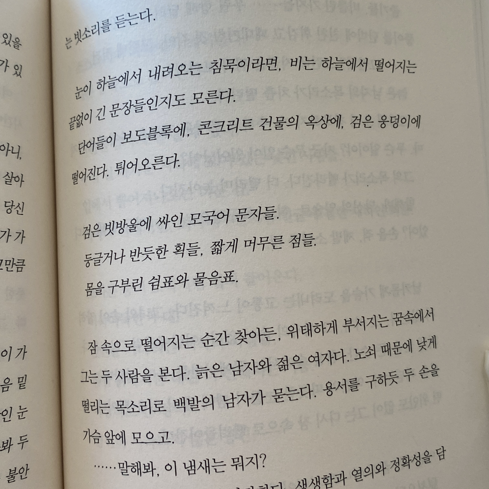

 > 
 > \[!quote\]
 > 눈이 하늘에서 내려오는 침묵이라면, 비는 하늘에서 떨어지는 끝없이 긴 문장들인지도 모른다.  
 > 단어들이 보도블록에, 콘크리트 건물의 옥상에, 검은 웅덩이에 떨어진다. 튀어오른다.
 > 
 > 검은 빗방울에 싸인 모국어 문자들.  
 > 둥글거나 반듯한 획들, 짧게 머무른 점들.  
 > 몸을 구부린 쉼표와 물음표.

한강 : 디 에센셜 ( 희랍어 시간 ) / 한강 / 문학동네 / 195p

겨울, 모든 소리를 삼키는 눈은 침묵을, 장마. 끝없이 떨어지는 비는 흐르는 문장들을 들려줍니다. 바닥에 부딪혀 다시 튀어 오르는 물방울처럼, 우리들의 침묵도 언젠가 문장으로 솟아오르기를 꿈꿉니다.  
겨울의 고요와 장마의 웅성거림 사이를 건너는 문장입니다. 가을은 여름비가 남긴 소란을 추스르며 다가올 눈의 침묵을 예감하게 하는 ‘사이’의 계절입니다. 비처럼 떨어진 단어들을 낙엽 사이에 묻어두고, 첫눈 내릴 때, 고요 속 새로운 문장으로 피어나길 바라는 마음을 담아 한강 작가님의 문구를 전합니다.

